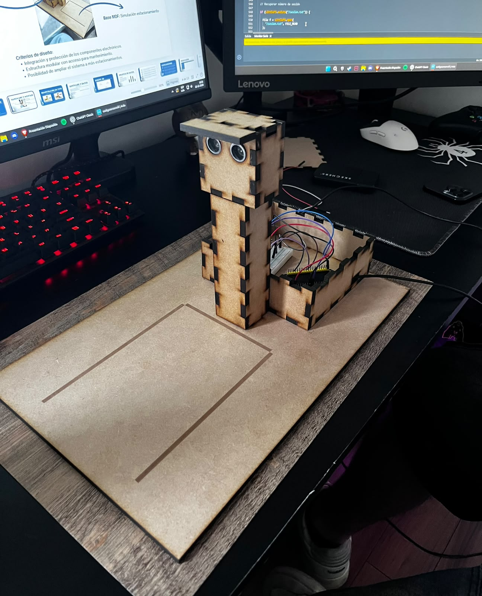

# Estacionamiento Inteligente UAI

Prototipo IoT que detecta si un espacio de estacionamiento está **libre u ocupado** con un sensor ultrasónico, muestra la disponibilidad en un **dashboard web** accesible desde el celular y **guarda un historial** de ocupación en la memoria del ESP32. Proyecto del ramo TEI201 — Taller de Diseño en Ingeniería, Universidad Adolfo Ibáñez, Campus Peñalolén.



## Equipo — Grupo 1, Sección 4

| Integrante | Rol |
|---|---|
| Sebastián Cáceres | Diseño 3D y encapsulado |
| Maximiliano Riffo | Hardware y circuito |
| Santiago Marín | Programación (software) |
| Joaquín Paiva | Documentación y repositorio |
| Mariano Pedrosa | Testing e investigación |

## Problema (Avance 1)

**ODS 11 — Ciudades y comunidades sostenibles.** El proyecto propone una solución tecnológica orientada a mejorar la movilidad, optimizar el uso de la infraestructura y contribuir a la reducción de recorridos vehiculares innecesarios.

En la Universidad Adolfo Ibáñez, Campus Peñalolén, los estudiantes que se trasladan en automóvil enfrentan dificultades para encontrar estacionamientos disponibles, especialmente durante los horarios de mayor demanda. Esta situación genera recorridos innecesarios dentro del campus, aumenta los tiempos de búsqueda y contribuye a la congestión vehicular.

El problema se debe, principalmente, a la **falta de información en tiempo real sobre la disponibilidad de estacionamientos**, lo que obliga a los conductores a recorrer distintos sectores sin saber dónde existen espacios libres.

## Solución y arquitectura

```
[HC-SR04] --pulso/eco--> [ESP32] --WiFi propio--> [Dashboard web en el celular]
 mide distancia           calcula distancia,        estado LIBRE/OCUPADO, espacios
                          decide ocupado (<15 cm)   disponibles, % ocupación, tiempo
                               |                    ocupado, n° de ocupaciones,
                               v                    gráfico y descarga del CSV
                     [LittleFS: historial.csv]
                      memoria flash del ESP32, persiste al reiniciar
```

- **Captura:** el sensor mide cada ~200 ms.
- **Almacenamiento:** se guarda un registro en `historial.csv` cada 10 s y en cada cambio de estado.
- **Visualización:** el dashboard consulta el estado cada 1 s y el gráfico cada 10 s.
- **Información:** porcentaje del tiempo ocupado, tiempo ocupado, número de ocupaciones y espacios disponibles.

El prototipo monitorea **un espacio**. No se ha medido todavía si reduce el tiempo de búsqueda: el sistema busca facilitar esa búsqueda entregando información de disponibilidad.

## Estructura del repositorio

```
├── README.md
├── FUENTES.md                 # Librerías, código externo y uso de IA (obligatorio)
├── firmware/                  # Código del ESP32 (Arduino IDE)
│   └── codigosensorwifi/codigosensorwifi.ino
├── hardware/                  # Esquemático, BOM, fotos, justificación de componentes
├── diseño-3d/                 # Gemelo 3D (STEP/.f3d), planos PDF, renders, archivos de corte láser, versión real
├── testing/                   # Protocolo de pruebas, resultados, datos CSV y evidencias
├── docs/                      # Reporte final y presentación
└── iteraciones/               # Historial v1 → v2 → v3
```

## Componentes para replicar el hardware

| Componente | Cantidad |
|---|---|
| ESP32 Dev Module (38 pines) | 1 |
| Sensor ultrasónico HC-SR04 | 1 |
| Resistencias 10 kΩ (divisor de voltaje en ECHO) | 3 |
| Protoboard 8,5 × 5,4 cm | 1 |
| Cables Dupont | ~10 |
| Power bank USB 5 V + cable USB | 1 |
| Piezas de MDF 5,5 mm cortadas con láser | ver `diseño-3d/corte_laser/` |

Conexiones: **VCC → 5V**, **TRIG → GPIO18**, **ECHO → GPIO19 a través del divisor** (10 kΩ arriba, 2 × 10 kΩ en serie abajo ≈ 3,3 V), **GND → GND**. Detalle en [`hardware/`](hardware/) y en el [esquemático](hardware/esquematico.pdf). BOM con costos en [`hardware/BOM.xlsx`](hardware/BOM.xlsx).

## Cargar el firmware

1. Instalar **Arduino IDE** y el paquete de placas **esp32 (Espressif Systems)** desde *Herramientas → Placa → Gestor de placas*.
2. Abrir `firmware/codigosensorwifi/codigosensorwifi.ino`.
3. Elegir *Herramientas → Placa → **ESP32 Dev Module***.
4. En *Herramientas → Partition Scheme* usar un esquema que incluya partición de archivos (por ejemplo **Default 4MB with spiffs**). El código usa `LittleFS.begin(true)`, que formatea la partición la primera vez si no puede montarla (esto borra datos previos de esa partición).
5. Conectar el ESP32 por USB y presionar **Subir**. Monitor serie: **115200 baudios**.
6. **Si el botón BOOT no responde** (nuestra placa lo tiene dañado): desconectar el USB, puentear **GPIO0 con GND**, conectar el USB, subir el código, desconectar, **retirar el puente** y volver a conectar. El mensaje `Hard resetting via RTS pin...` al final de la carga es normal.

Librerías: `WiFi.h`, `WebServer.h` y `LittleFS.h`, todas incluidas en el paquete esp32 (no requieren instalación aparte). Ver [`FUENTES.md`](FUENTES.md).

## Usar el dashboard

1. Alimentar el ESP32 (power bank conectado por USB).
2. En el celular o computador, conectarse a la red WiFi **`Estacionamiento_UAI`**, contraseña **`parking123`**.
3. Abrir **http://192.168.4.1** en el navegador.
4. Ver el estado (LIBRE en verde, OCUPADO en rojo, SIN LECTURA en naranjo), los indicadores y el gráfico de los últimos 60 registros.
5. Botón **Descargar historial CSV** → archivo `historial.csv` (columnas `sesion, segundos, distancia_cm, estado`).

El dashboard funciona sin internet: lo sirve el propio ESP32. Para una instalación definitiva se recomienda cambiar la contraseña.

## Resultados de las pruebas

| Indicador | Resultado |
|---|---|
| Detección (20 pruebas) | 20/20 correctas (100 % en las condiciones probadas) |
| Mayor error absoluto de distancia (5–30 cm) | 3 cm (a 20 cm) |
| Tiempo de actualización del dashboard | ≈ 1 s (observado) |
| Almacenamiento CSV | Funcional: 365 registros en 10 sesiones; el historial se mantiene tras 9 reinicios |

Protocolo, datos y análisis de fallas en [`testing/`](testing/).

## Limitaciones conocidas

- Monitorea **un solo espacio**.
- Acceso **local**: hay que conectarse a la red del ESP32 (no hay acceso remoto desde el campus).
- El CSV registra **segundos desde el encendido**, no fecha y hora reales (sin reloj ni internet).
- El porcentaje y el tiempo ocupado del dashboard corresponden a la **sesión actual** (se reinician al apagar); el CSV sí conserva todas las sesiones.
- El CSV se limita a ~180 KB para no llenar la memoria.
- Se observaron lecturas atípicas, registros SIN LECTURA y alternancias cerca del umbral, que inflan el contador de ocupaciones. Falta un filtro (mediana) e histéresis.

## Mejoras futuras

- Un sensor por espacio y agrupación por sectores (ver la [versión real propuesta](diseño-3d/version_real/): un nodo con panel solar controla 4 espacios).
- Envío de datos a un servidor o a la nube para consultar la disponibilidad antes de llegar.
- Filtrado de lecturas y histéresis en el umbral de 15 cm.
- Fecha y hora reales (NTP o módulo RTC) y almacenamiento de largo plazo.

## Estado del proyecto

- **Versión:** v3.0 — Prototipo IoT completo (Avance #3)
- **Última actualización:** 22/11/2026
