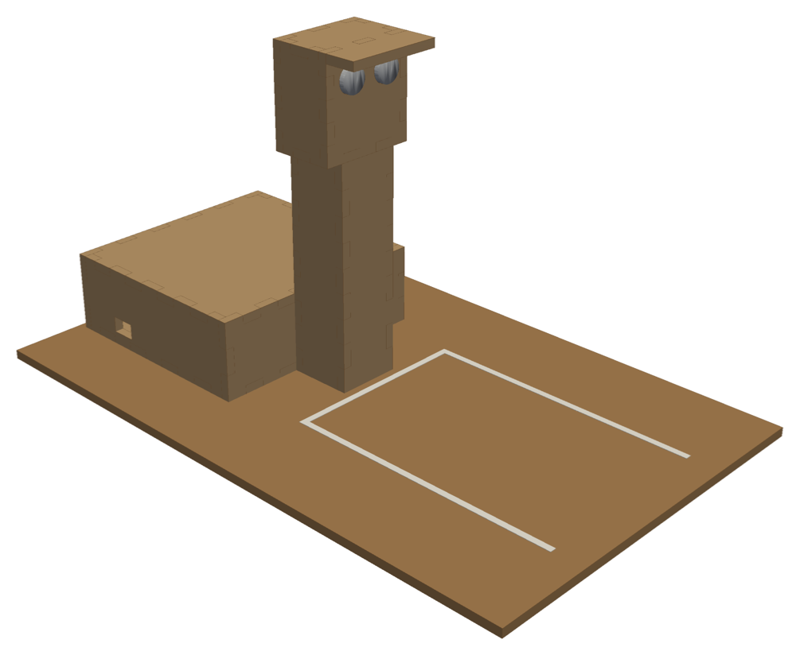
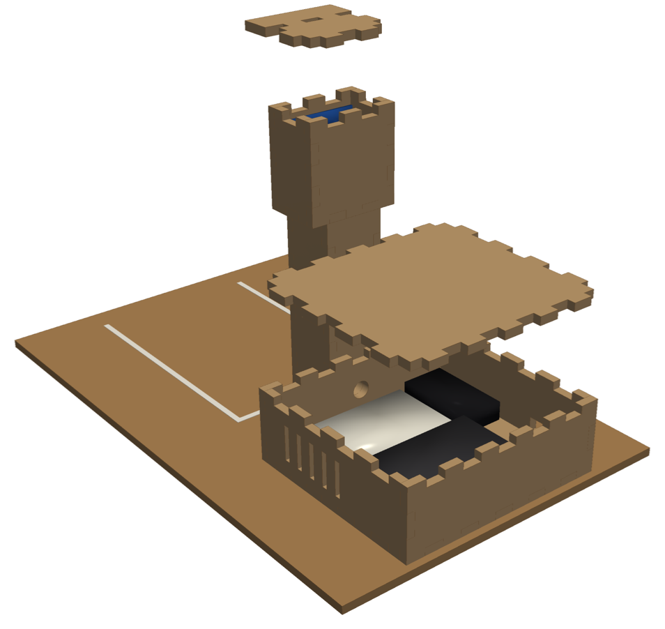
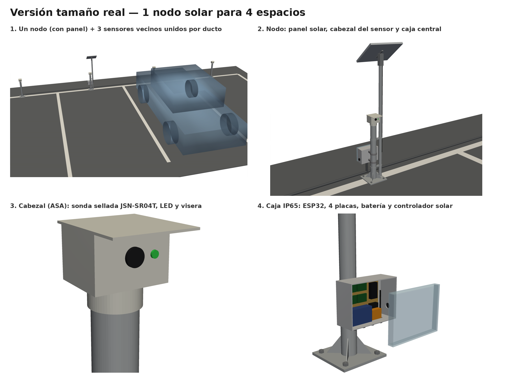

# Diseño 3D y encapsulado

## Archivos

| Archivo | Contenido |
|---|---|
| `encapsulado.f3d` | Gemelo 3D en Fusion 360 — **pendiente de exportar** (ver abajo) |
| [`maqueta_MDF_5.5mm_ensamble.step`](maqueta_MDF_5.5mm_ensamble.step) | Gemelo 3D completo: todas las piezas de MDF + ESP32, protoboard, power bank y HC-SR04 como volúmenes con sus medidas reales |
| [`planos.pdf`](planos.pdf) | Planos técnicos (4 láminas): conjunto con vistas ortogonales y piezas cotadas, escala, tolerancias |
| [`renders/`](renders/) | Vista exterior y vista interior con las tapas levantadas |
| [`corte_laser/`](corte_laser/) | Archivos DXF que se cortaron en el DEC, mapa de piezas y el generador paramétrico |
| [`version_real/`](version_real/) | Propuesta a tamaño real con materiales para exterior y energía solar |

### Cómo obtener el `.f3d`

1. Abrir Fusion 360 → **Archivo → Abrir → Abrir desde mi equipo** → `maqueta_MDF_5.5mm_ensamble.step`.
2. Guardar el diseño en Fusion.
3. **Archivo → Exportar → tipo "Archivos de Fusion 360 (.f3d)"** → guardar como `encapsulado.f3d` en esta carpeta.

## Gemelo 3D

| | |
|---|---|
|  |  |
| Exterior | Tapas levantadas: protoboard, ESP32 y power bank en la caja central; HC-SR04 (azul) en la caja del sensor |

Componentes modelados como volúmenes con medidas reales (dentro de la caja central de 145 × 135 × 50 mm):

| Componente | Medidas | Posición |
|---|---|---|
| ESP32 | 57 × 30 × 13 mm | Adelante, a la izquierda |
| Protoboard | 85 × 54 × 9 mm | Adelante, a la derecha |
| Power bank | 100 × 65 × 15 mm | Atrás, con ~34 mm libres para el enchufe USB |
| HC-SR04 | Placa 45 × 20 mm + 2 transductores Ø16 mm | Dentro de la caja del sensor, arriba del poste |

## Decisiones de diseño

- **Electrónica separada del sensor.** El sensor va arriba del poste, apuntando al espacio; el ESP32, la protoboard y la batería van en una caja aparte, protegidos. El cable baja por dentro del poste y entra a la caja por un agujero de Ø12 mm a 25 mm del piso.
- **Altura del sensor.** El eje de los transductores queda a 185,5 mm sobre la base, a la altura del objeto que se detecta en la maqueta. El umbral de ocupado es de 15 cm.
- **Visera.** La tapa de la caja del sensor sobresale 20 mm hacia adelante, como protección (representa la protección contra lluvia de la versión real).
- **Diseño para la reparación.** Las tapas de la caja central y de la caja del sensor van encastradas sin pegamento: se abren con la mano. La caja central tiene:
  - ranuras de ventilación (5 × 4 × 24 mm);
  - una ranura de 16 × 10 mm alineada con el puerto del power bank, para cargarlo.
- **Ajuste a las medidas reales.** La caja central se rediseñó cuando el equipo midió el power bank (10 × 6,5 × 1,5 cm): la primera versión no dejaba espacio para el enchufe USB. El poste bajó de 160 a 140 mm para que todas las piezas cupieran en el pedazo de MDF disponible (35 × 40 cm).
- **Fabricación.** Corte láser en MDF de 5,5 mm. Las uniones son de encastre, con dientes de profundidad igual al espesor del MDF. Los archivos cumplen el formato del DEC: DXF en mm, rojo = corte, azul = grabado, amarillo = delineado.

## Planos técnicos

[`planos.pdf`](planos.pdf), método europeo (ISO-E, 1er diedro), unidades en mm:

| Lámina | Contenido | Escala |
|---|---|---|
| 1 | Conjunto: vista frontal, lateral izquierda y superior, con medidas generales y lista de conjuntos | 1:2 |
| 2 | Caja central, piezas C1–C6 | 1:1 |
| 3 | Poste (P1–P4) y caja del sensor (S1–S6) | 1:1 |
| 4 | Base | 1:2 |

**Tolerancias:**
- Generales según ISO 2768-m.
- Agujeros de los transductores: Ø16,4 ±0,1 mm (transductor de Ø16 mm).
- Ranuras y lengüetas del poste: 5,5 mm +0,2/0.

## Maqueta vs. versión real

La maqueta valida el funcionamiento. La versión real mantiene el mismo concepto (sensor en un poste y electrónica en una caja que se abre), pero cambia los materiales para resistir sol, lluvia y golpes:

| Parte | Maqueta | Versión real |
|---|---|---|
| Sensor | HC-SR04 | JSN-SR04T (ultrasónico con sonda sellada) |
| Caja del sensor | MDF | ASA (plástico resistente a UV) |
| Caja central | MDF | Caja estanca IP65 de policarbonato, con prensaestopas |
| Poste | MDF | Acero galvanizado en caliente, anclado con pernos |
| Conexiones | Protoboard + Dupont | Placa perforada soldada |
| Energía | Power bank | Panel solar + batería de litio + controlador de carga |
| Escala | 1 espacio | 1 nodo (1 ESP32) controla 4 espacios; los 3 sensores vecinos se conectan por un ducto |

Las medidas de la versión real (sensor a ~65 cm, caja de 20 × 15 × 10 cm, panel de ~35 × 30 cm) son **una propuesta**. El panel y la batería deben dimensionarse según el consumo real del sistema y las horas de sol.
