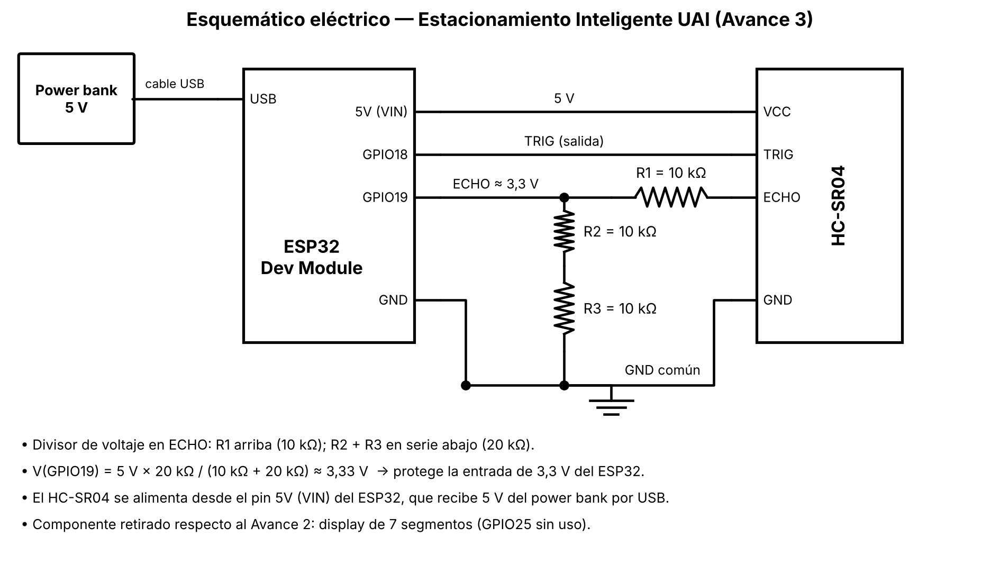
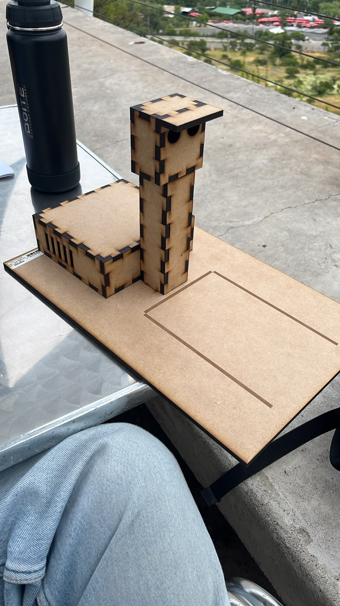
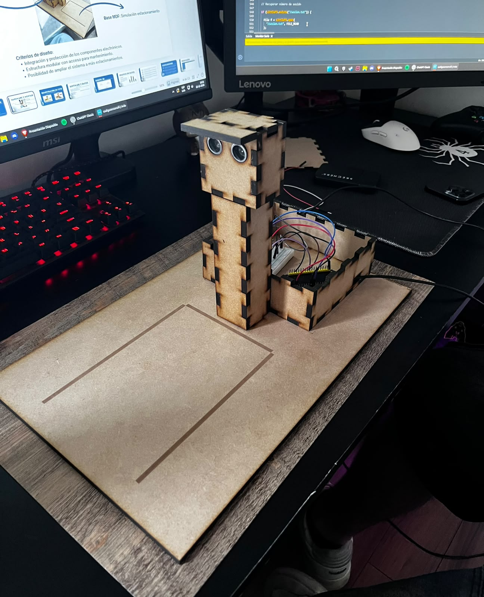
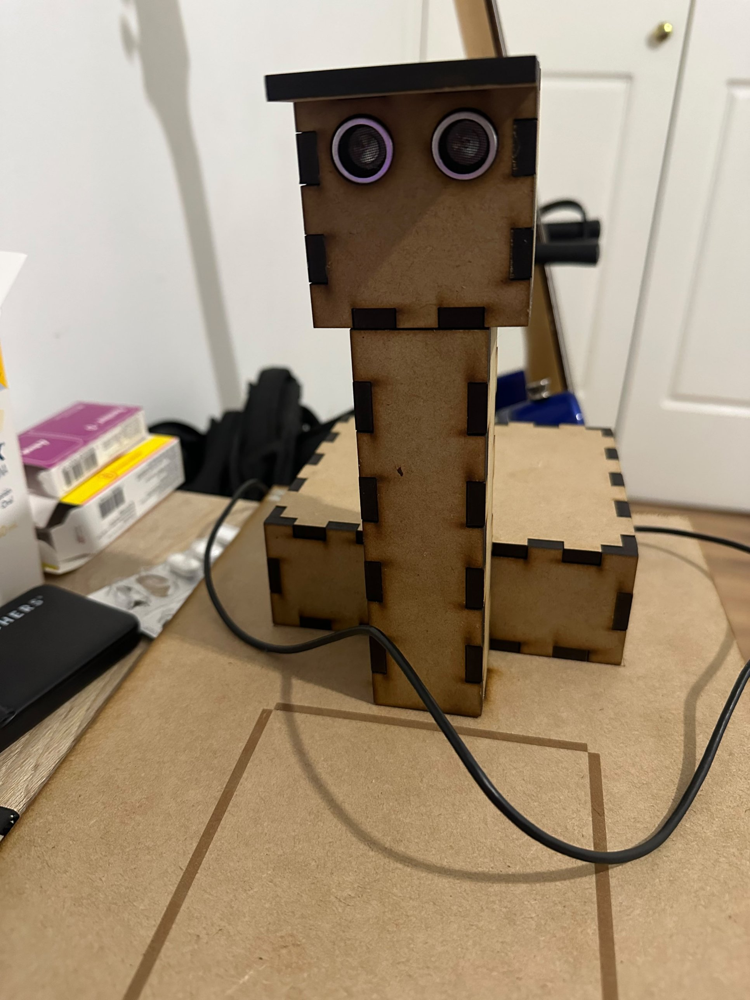
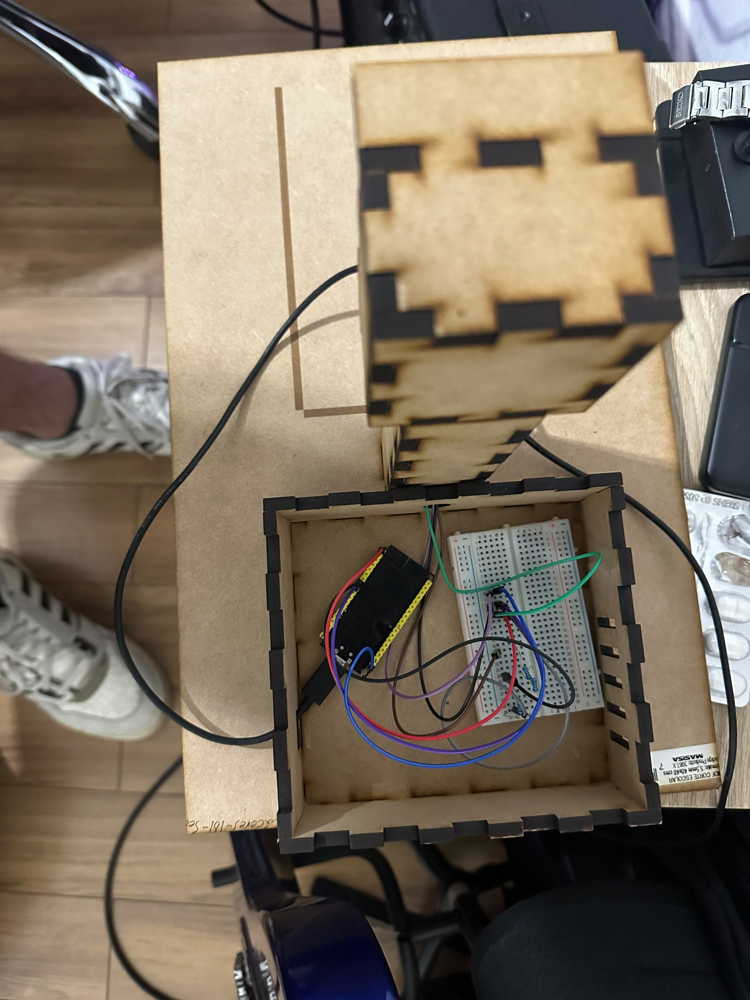

# Hardware

## Archivos

| Archivo | Contenido |
|---|---|
| [`esquematico.pdf`](esquematico.pdf) / [`.png`](esquematico.png) | Esquemático eléctrico del circuito definitivo |
| [`BOM.xlsx`](BOM.xlsx) | Lista de materiales con cantidades, especificación y costos |
| [`fotos/`](fotos/) | Fotografías del prototipo armado |

## Esquemático

| Pin HC-SR04 | Conexión en el ESP32 |
|---|---|
| VCC | 5V (VIN) |
| TRIG | GPIO18 |
| ECHO | GPIO19, a través del divisor de voltaje |
| GND | GND |

**Divisor de voltaje:** el HC-SR04 entrega 5 V en ECHO y las entradas del ESP32 trabajan a 3,3 V. Por eso ECHO pasa por R1 = 10 kΩ hasta GPIO19, y desde ese punto hay dos resistencias de 10 kΩ en serie (20 kΩ) a GND:

V(GPIO19) = 5 V × 20 kΩ / (10 kΩ + 20 kΩ) ≈ **3,33 V**

**Alimentación:** power bank → cable USB → ESP32. En la demo el power bank queda fuera de la caja; la caja central tiene espacio reservado para guardarlo. El sensor se alimenta desde el pin 5V (VIN) del ESP32. Todos los GND son comunes.

**Cambio respecto al Avance 2:** se retiró el display de 7 segmentos (antes en GPIO25). Toda la visualización está en el dashboard web.

## Justificación de componentes

| Componente | Por qué lo elegimos | Alternativas descartadas |
|---|---|---|
| **ESP32 Dev Module** | WiFi integrado: crea su propia red y sirve el dashboard sin módulos extra. Tiene memoria flash para guardar el historial (LittleFS). Se programa con Arduino IDE. Estaba disponible en el DEC. | Arduino Uno: no tiene WiFi; habría necesitado un módulo adicional y no tiene sistema de archivos para el historial. |
| **HC-SR04** | Mide distancia (2–400 cm), así que detecta un auto estacionado aunque esté quieto. Es barato, conocido y fácil de leer con dos pines. | Sensor de movimiento (PIR): solo detecta cambios; un auto detenido dejaría de detectarse. |
| **Divisor 3 × 10 kΩ** | Baja la señal ECHO de 5 V a ~3,3 V para no dañar el ESP32, con resistencias del mismo valor que había disponibles. | Conexión directa: arriesga dañar la entrada del ESP32. |
| **Protoboard** | Permite montar y corregir el circuito sin soldar durante el prototipado. | Placa soldada: queda para la versión real. |
| **Power bank** | Alimentación portátil por USB (5 V), sin cables a un computador durante la demo. Cabe en la caja central. | Cable USB al computador: limita dónde se puede poner la maqueta. |
| **MDF 5,5 mm cortado con láser** | Rápido y preciso de fabricar en el DEC. Las uniones de encastre permiten armar sin tornillos y abrir las tapas para reparar. | Caja impresa en 3D: más lenta de fabricar en este tamaño. |

En la versión real se cambiarían los materiales para exterior (ver `diseño-3d/version_real/`): sensor sellado JSN-SR04T, caja IP65, poste de acero galvanizado, placa soldada y energía solar.

## BOM (resumen)

| # | Componente | Cant. | Origen | Costo total (CLP) |
|---|---|---|---|---|
| 1 | ESP32 Dev Module (38 pines) | 1 | Préstamo DEC | $0 |
| 2 | Sensor ultrasónico HC-SR04 | 1 | Préstamo DEC | $0 |
| 3 | Resistencia 10 kΩ | 3 | Préstamo DEC | $0 |
| 4 | Protoboard 8,5 × 5,4 cm | 1 | Préstamo DEC | $0 |
| 5 | Cables Dupont (paquete de 40, $100 c/u) | 40 | Compra | $4.000 |
| 6 | Power bank USB 5 V (10 × 6,5 × 1,5 cm) | 1 | Préstamo DEC | $0 |
| 7 | Cable USB | 1 | Préstamo DEC | $0 |
| 8 | Plancha MDF 5,5 mm, 40 × 40 cm ($2.500 c/u) | 2 | Compra | $5.000 |
| 9 | Corte y grabado láser | 1 | Servicio DEC | $0 |
| | **Total para el equipo** | | | **$9.000** |

Detalle con especificaciones en [`BOM.xlsx`](BOM.xlsx).

## Montaje físico

La maqueta es de **MDF de 5,5 mm cortado con láser en el DEC**, con uniones de encastre (dientes):

- **Base** (24 × 38 cm) con el espacio de estacionamiento grabado.
- **Poste** de 40 × 40 × 140 mm. El cable del sensor baja por dentro.
- **Caja del sensor** arriba del poste. Los transductores del HC-SR04 asoman por dos agujeros de Ø16,4 mm y la tapa superior hace de visera.
- **Caja central** (145 × 135 × 50 mm) detrás del poste, con el ESP32 y la protoboard, y espacio para el power bank. Tiene:
  - ranuras de ventilación;
  - una ranura para el USB;
  - un agujero de Ø12 mm para el cable del sensor.

**Acceso para reparación:** las tapas de la caja central y de la caja del sensor van **encastradas sin pegamento**. Se levantan con la mano y dejan ver y cambiar los componentes, sin herramientas. Las piezas, medidas y archivos de corte están en [`../diseño-3d/`](../diseño-3d/).

## Fotografías

| | |
|---|---|
|  |  |
| 1. Maqueta armada, vista lateral | 2. Caja central abierta junto al poste |
|  |  |
| 3. Vista frontal: sensor en la caja con visera, poste y caja central detrás | 4. Vista superior: ESP32, protoboard con divisor y cables hacia el poste |

Las fotos del prototipo del Avance 2 están en `iteraciones/iteracion_2/fotos_v2/`.
