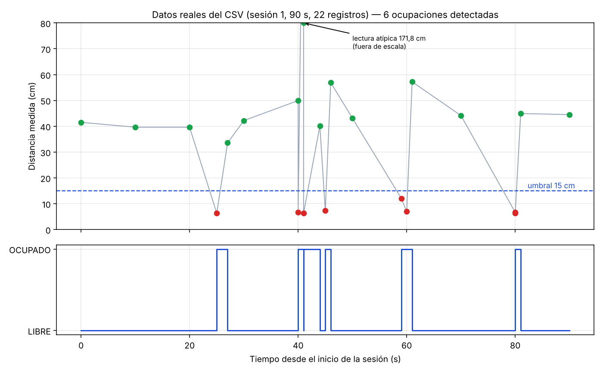

# Resultados y validación — Avance 3

Protocolo en [`protocolo_pruebas.md`](protocolo_pruebas.md). Todos los valores son mediciones del equipo.

## Resumen

| Prueba | Resultado | ¿Cumple? |
|---|---|---|
| P1 Detección | **20/20 correctas → 100 %** en las condiciones probadas | Sí |
| P2 Precisión | **Error máximo 3 cm** (a 20 cm); 0 cm entre 5 y 15 cm | Sí |
| P3 Tiempo de respuesta | **≈ 1 s** (observado, sin instrumento de precisión) | Sí |
| P4 Almacenamiento | **CSV funcional:** se descargó con registros periódicos y por cambio de estado | Sí |
| P5 Persistencia | El historial **se mantuvo** tras reiniciar (comprobado por el equipo) | Sí* |

\* La descarga incluida en `datos/historial.csv` es de una sesión corta (sesión 1). Falta adjuntar un CSV descargado después de un reinicio, con registros de la sesión 2, como evidencia.

## P1 — Detección

| Total | Correctas | Incorrectas | Exactitud |
|---|---|---|---|
| 20 | 20 | 0 | 100 % |

Significa que el sistema respondió bien en las 20 pruebas realizadas. No es una precisión garantizada para cualquier condición.

## P2 — Precisión del HC-SR04

| Distancia real | Distancia medida | Error absoluto |
|---|---|---|
| 5 cm | 5 cm | 0 cm |
| 10 cm | 10 cm | 0 cm |
| 15 cm | 15 cm | 0 cm |
| 20 cm | 17 cm | 3 cm |
| 30 cm | 28–30 cm (fluctúa) | 0–2 cm |

En la zona que decide el estado (bajo 15 cm) las lecturas coincidieron con la distancia real. Sobre 20 cm aparece error y fluctuación, pero no cambia la clasificación, porque esas distancias siempre quedan sobre el umbral.

## P3 — Tiempo de respuesta

El dashboard cambió de estado en **≈ 1 segundo**. Es coherente con el diseño: el sensor mide cada 200 ms y la página consulta `/estado` cada 1 s. Es un valor observado, no medido con instrumento.

## P4 — Almacenamiento: datos reales del CSV

Archivo: [`datos/historial.csv`](datos/historial.csv). Corresponde a la sesión 1: 90 s y 22 registros.

| Dato | Valor |
|---|---|
| Ocupaciones detectadas (paso a OCUPADO) | 6 (en t = 25, 40, 41, 45, 59 y 80 s) |
| Distancias con estado OCUPADO | 6,31 – 12,07 cm (todas < 15 cm) |
| Distancias con estado LIBRE | 33,56 – 57,20 cm, más 1 lectura atípica de 171,79 cm |
| Registros periódicos | cada 10 s (t = 0, 10, 20, …, 90) |
| Registros por cambio de estado | sí; algunos coinciden en el mismo segundo con el periódico |

Las 22 filas del CSV quedan bien clasificadas según el umbral: ninguna lectura bajo 15 cm aparece como LIBRE ni ninguna sobre 15 cm como OCUPADO.

## Análisis de fallas

### Falla 1 — «Almacenamiento no disponible» (resuelta)
- **Síntoma:** el dashboard funcionaba, pero al descargar el CSV aparecía «Almacenamiento no disponible».
- **Causa:** LittleFS no lograba montar la partición. El código usaba `LittleFS.begin(false)`, que no formatea una partición nueva.
- **Solución:** cambiar a `LittleFS.begin(true)` (línea 535) para que formatee la partición si no se puede montar.
- **Resultado:** el CSV se guarda y se descarga (P4).

### Falla 2 — Lecturas atípicas y fluctuación del sensor (identificada, sin resolver)
- **Síntoma:**
  - En el CSV, a los 41 s, aparece una lectura de **171,79 cm** entre dos lecturas de ~6 cm (registrada como LIBRE).
  - En P2, a 20 cm se midió 17 cm y a 30 cm la lectura fluctuó entre 28 y 30 cm.
- **Causa probable:** ecos que rebotan en ángulo o en superficies irregulares (la mano). El firmware usa una sola lectura por medición, sin filtro.
- **Efecto:** un cambio LIBRE/OCUPADO momentáneo que puede sumar una ocupación de más al contador.
- **Mejora propuesta (no implementada):**
  - Tomar la **mediana de 3–5 lecturas** por medición.
  - Agregar **histéresis**: por ejemplo, ocupado bajo 14 cm y libre sobre 16 cm, o exigir que el estado se repita durante ~1 s antes de cambiar.

### Falla 3 — Botón BOOT defectuoso (resuelta con procedimiento)
- **Síntoma:** el ESP32 no entraba en modo programación.
- **Solución:** puentear GPIO0 con GND durante la carga y retirar el puente después (pasos en el README).

## Validación contra el problema original

En el Avance 1 identificamos que el problema de fondo es la **falta de información en tiempo real** sobre qué espacios están libres, lo que obliga a recorrer el estacionamiento buscando.

Las pruebas muestran que el prototipo:
- detecta si el espacio está ocupado (20/20);
- entrega esa información en el celular en ≈ 1 s;
- guarda un historial que permite saber **cuánto tiempo** estuvo ocupado el espacio y **cuántas veces** se ocupó.

Con un sensor por espacio, ese mismo dato permitiría:
- a un conductor, ver antes de recorrer si hay espacios libres;
- a la universidad, identificar sectores y horarios de mayor demanda.

**Lo que sí demuestra:** que es técnicamente viable detectar y comunicar la disponibilidad de un espacio y registrar su uso.
**Lo que no demuestra todavía:** que se reduzca el tiempo de búsqueda. Para eso hace falta una prueba con usuarios y varios espacios, comparando tiempos con y sin el sistema.
