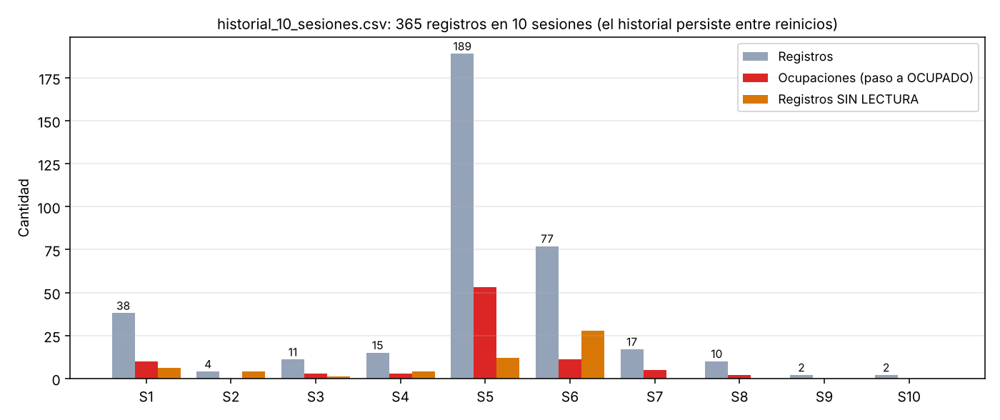
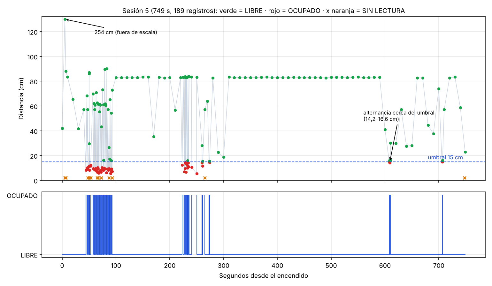

# Resultados y validación — Avance 3

Protocolo en [`protocolo_pruebas.md`](protocolo_pruebas.md). Todos los valores son mediciones del equipo.

## Resumen

| Prueba | Resultado | ¿Cumple? |
|---|---|---|
| P1 Detección | **20/20 correctas → 100 %** en las condiciones probadas | Sí |
| P2 Precisión | **Error máximo 3 cm** (a 20 cm); 0 cm entre 5 y 15 cm | Sí |
| P3 Tiempo de respuesta | **≈ 1 s** (observado, sin instrumento de precisión) | Sí |
| P4 Almacenamiento | **CSV funcional:** 365 registros descargados, periódicos y por cambio de estado | Sí |
| P5 Persistencia | **10 sesiones (9 reinicios) en el mismo archivo**; los registros de la sesión 1 siguen intactos | Sí |

## P1 — Detección

| Total | Correctas | Incorrectas | Exactitud |
|---|---|---|---|
| 20 | 20 | 0 | 100 % |

Significa que el sistema respondió bien en las 20 pruebas realizadas. No es una precisión garantizada para cualquier condición.

## P2 — Precisión del HC-SR04

| Distancia real | Distancia medida | Error absoluto |
|---|---|---|
| 5 cm | 5 cm | 0 cm |
| 10 cm | 10 cm | 0 cm |
| 15 cm | 15 cm | 0 cm |
| 20 cm | 17 cm | 3 cm |
| 30 cm | 28–30 cm (fluctúa) | 0–2 cm |

En la zona que decide el estado (bajo 15 cm) las lecturas coincidieron con la distancia real. Sobre 20 cm aparece error y fluctuación, pero no cambia la clasificación, porque esas distancias siempre quedan sobre el umbral.

## P3 — Tiempo de respuesta

El dashboard cambió de estado en **≈ 1 segundo**. Es coherente con el diseño: el sensor mide cada 200 ms y la página consulta `/estado` cada 1 s. Es un valor observado, no medido con instrumento.

## P4 y P5 — Almacenamiento y persistencia: datos reales

**Archivos en [`datos/`](datos/):**
- `historial_10_sesiones.csv`: descarga completa, con 365 registros de 10 sesiones.
- `historial_sesion1_parcial.csv`: primera descarga, con 22 registros de la sesión 1.

**Persistencia (P5).** Entre descargas el ESP32 se reinició 9 veces:
- El contador `sesion` pasó de 1 a 10.
- Las primeras 22 filas del archivo completo son idénticas a la primera descarga.
- El historial no se borra al apagar, y cada encendido se registra como una sesión nueva.

| Sesión | Registros | Duración (s) | Ocupaciones | SIN LECTURA |
|---|---|---|---|---|
| 1 | 38 | 140 | 10 | 6 |
| 2 | 4 | 30 | 0 | 4 |
| 3 | 11 | 20 | 3 | 1 |
| 4 | 15 | 50 | 3 | 4 |
| 5 | 189 | 749 | 53 | 12 |
| 6 | 77 | 71 | 11 | 28 |
| 7 | 17 | 60 | 5 | 0 |
| 8 | 10 | 53 | 2 | 0 |
| 9 | 2 | 10 | 0 | 0 |
| 10 | 2 | 10 | 0 | 0 |
| **Total** | **365** | | **87** | **55** |

**Clasificación.** Ningún registro está mal clasificado según el umbral:
- Todas las distancias con estado OCUPADO están entre **5,01 y 14,90 cm**.
- Ninguna lectura bajo 15 cm aparece como LIBRE.

**Coherencia con el dashboard.** Las capturas (`evidencias/dashboard_*.jpg`) muestran LIBRE a 116,9 cm, 26,8 % de ocupación, 0,1 min ocupado y **5 ocupaciones**. Coincide con la sesión 7 del CSV: 5 pasos a OCUPADO y distancia en reposo de ~117 cm.

La sesión 5 (la más larga) muestra:
- **Ráfagas de ocupación** en t ≈ 45–95 s y 220–275 s. Son las pruebas con la mano.
- **Reposo estable a ~83 cm** (LIBRE).
- **Alternancias** en t ≈ 608 y 706 s, cuando el objeto quedó justo en el umbral.

## Análisis de fallas

### Falla 1 — «Almacenamiento no disponible» (resuelta)
- **Síntoma:** el dashboard funcionaba, pero al descargar el CSV aparecía «Almacenamiento no disponible».
- **Causa:** LittleFS no lograba montar la partición. El código usaba `LittleFS.begin(false)`, que no formatea una partición nueva.
- **Solución:** cambiar a `LittleFS.begin(true)` (línea 535) para que formatee la partición si no se puede montar.
- **Resultado:** el CSV se guarda y se descarga (P4).

### Falla 2 — Lecturas atípicas y alternancia en el umbral (identificada, sin resolver)
- **Síntoma:**
  - El CSV tiene 3 lecturas atípicas (**171,79 cm**, **254,08 cm** y **183,25 cm**) entre lecturas normales.
  - En la sesión 5, con el objeto cerca de 15 cm, el estado alternó OCUPADO/LIBRE varias veces en 1–2 s (14,18 → 16,58 → 14,53 cm en t = 609 s).
  - En P2, a 20 cm se midió 17 cm y a 30 cm la lectura fluctuó entre 28 y 30 cm.
- **Causa probable:** ecos que rebotan en ángulo o en superficies irregulares (la mano). El firmware usa una sola lectura por medición, sin filtro.
- **Efecto:** cambios LIBRE/OCUPADO momentáneos que **inflan el contador de ocupaciones** (por ejemplo, 53 en la sesión 5, muchas en ráfagas de 1 s).
- **Mejora propuesta (no implementada):**
  - Tomar la **mediana de 3–5 lecturas** por medición.
  - Agregar **histéresis**: por ejemplo, ocupado bajo 14 cm y libre sobre 16 cm, o exigir que el estado se repita durante ~1 s antes de cambiar.

### Falla 3 — Registros SIN LECTURA (identificada)
- **Síntoma:** 55 de los 365 registros son SIN LECTURA (el sensor no recibió eco en 30 ms). Se concentran en las sesiones 2, 4 y 6, y aparecen en ráfagas.
- **Causa probable (no verificada):**
  - el objeto queda fuera del alcance del pulso o desviado del eje del sensor;
  - superficies que no reflejan bien el sonido;
  - un contacto intermitente en los cables Dupont que bajan por el poste.
- **Efecto:** el dashboard muestra SIN LECTURA y esos intervalos no cuentan en el % de ocupación (el código solo suma tiempo con lecturas válidas).
- **Mejora propuesta:**
  - revisar y asegurar las conexiones;
  - ignorar lecturas SIN LECTURA aisladas y mantener el último estado válido hasta tener 2–3 fallas seguidas.

### Falla 4 — Botón BOOT defectuoso (resuelta con procedimiento)
- **Síntoma:** el ESP32 no entraba en modo programación.
- **Solución:** puentear GPIO0 con GND durante la carga y retirar el puente después (pasos en el README).

## Validación contra el problema original

En el Avance 1 identificamos que el problema de fondo es la **falta de información en tiempo real** sobre qué espacios están libres, lo que obliga a recorrer el estacionamiento buscando.

Las pruebas muestran que el prototipo:
- detecta si el espacio está ocupado (20/20);
- entrega esa información en el celular en ≈ 1 s;
- guarda un historial que permite saber **cuánto tiempo** estuvo ocupado el espacio y **cuántas veces** se ocupó.

Con un sensor por espacio, ese mismo dato permitiría:
- a un conductor, ver antes de recorrer si hay espacios libres;
- a la universidad, identificar sectores y horarios de mayor demanda.

**Lo que sí demuestra:** que es técnicamente viable detectar y comunicar la disponibilidad de un espacio y registrar su uso.
**Lo que no demuestra todavía:** que se reduzca el tiempo de búsqueda. Para eso hace falta una prueba con usuarios y varios espacios, comparando tiempos con y sin el sistema.
